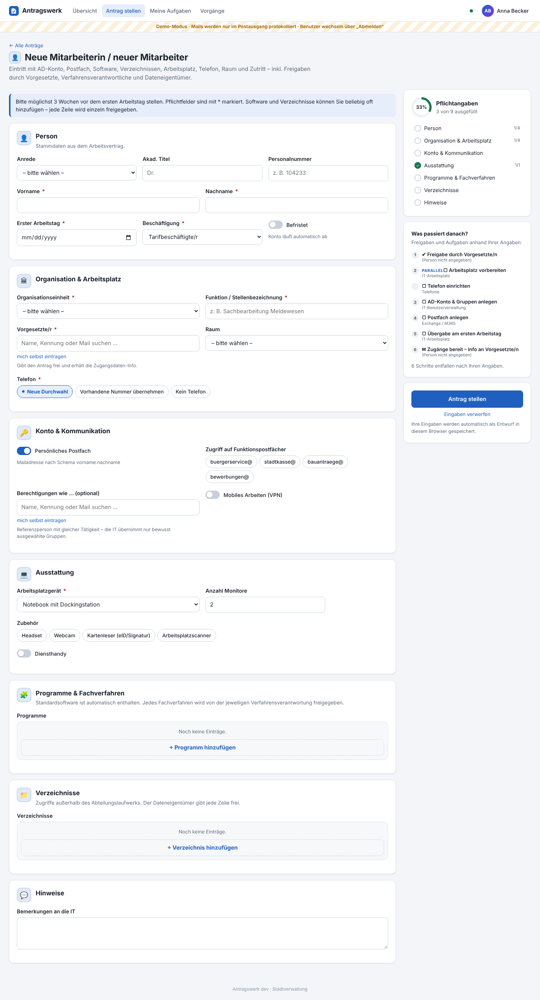
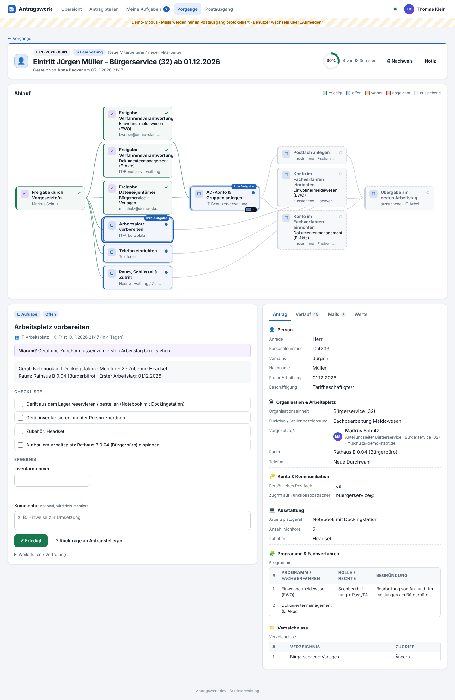
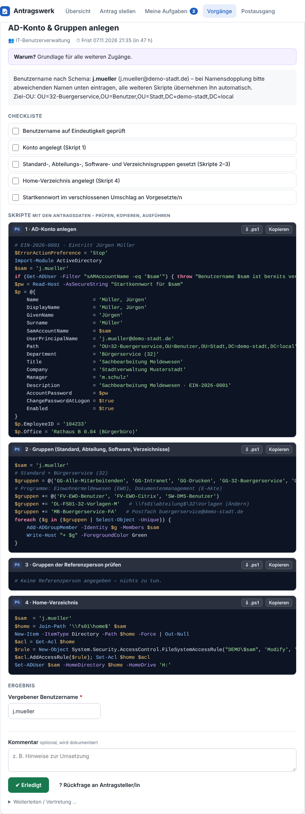
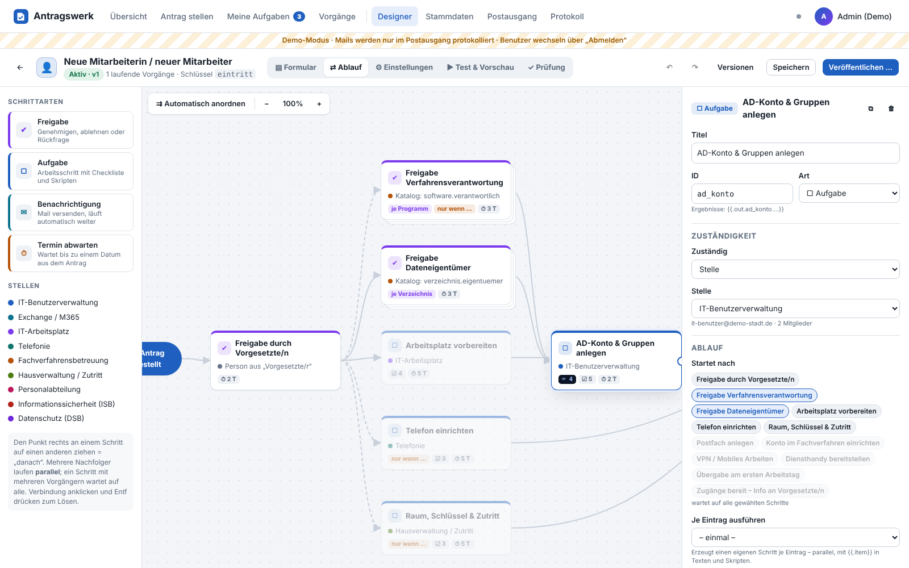
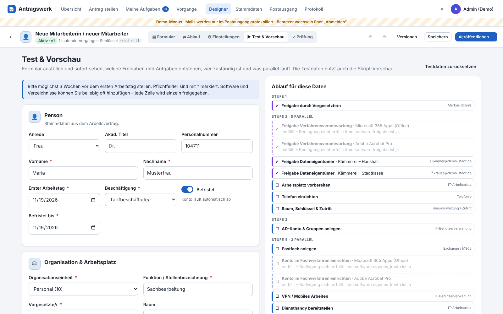
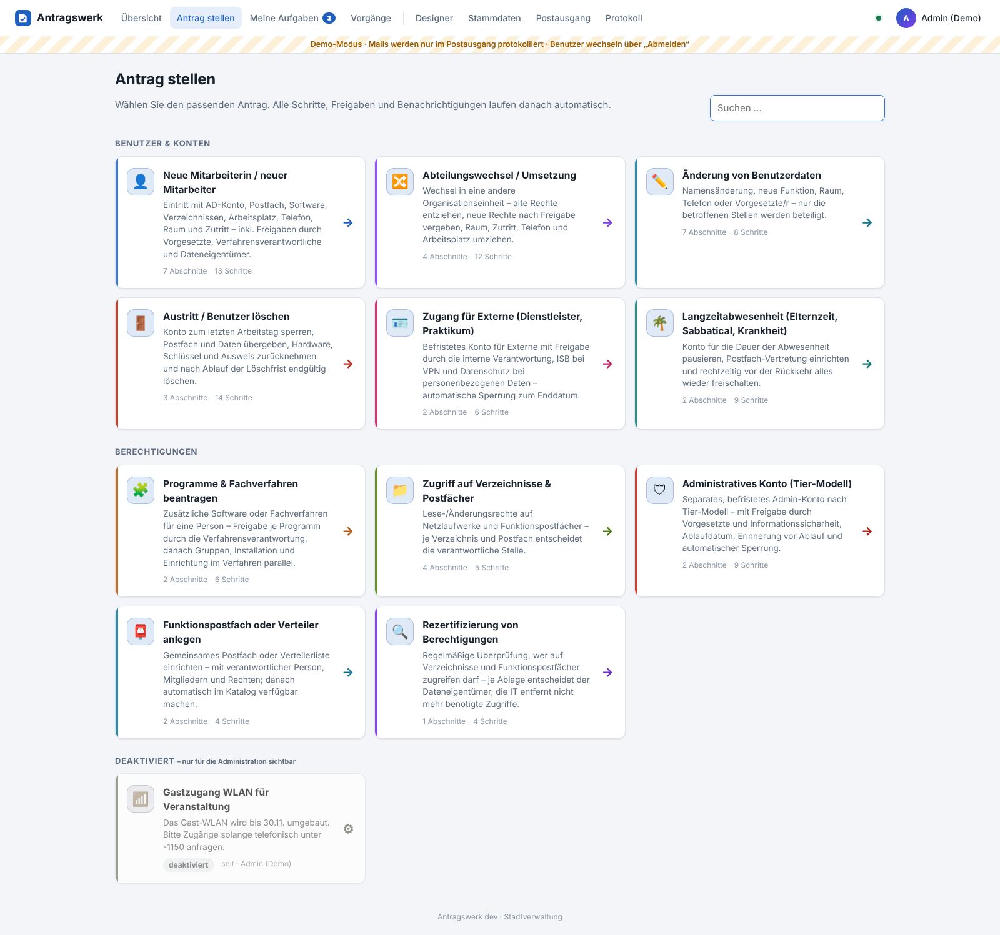
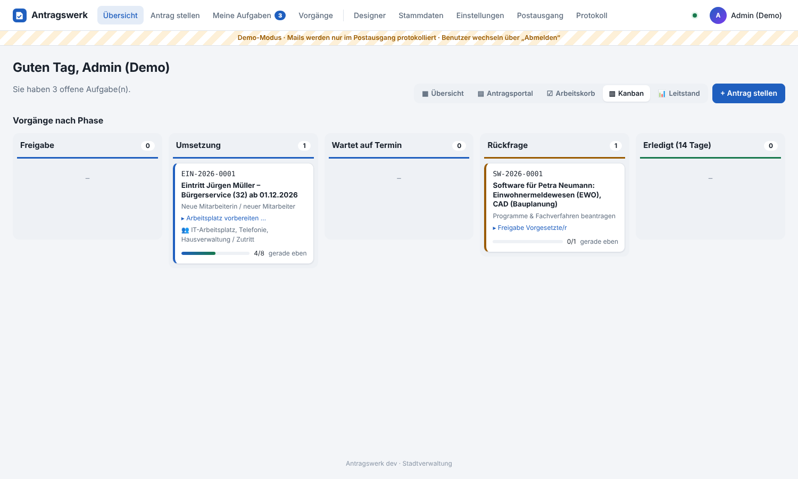
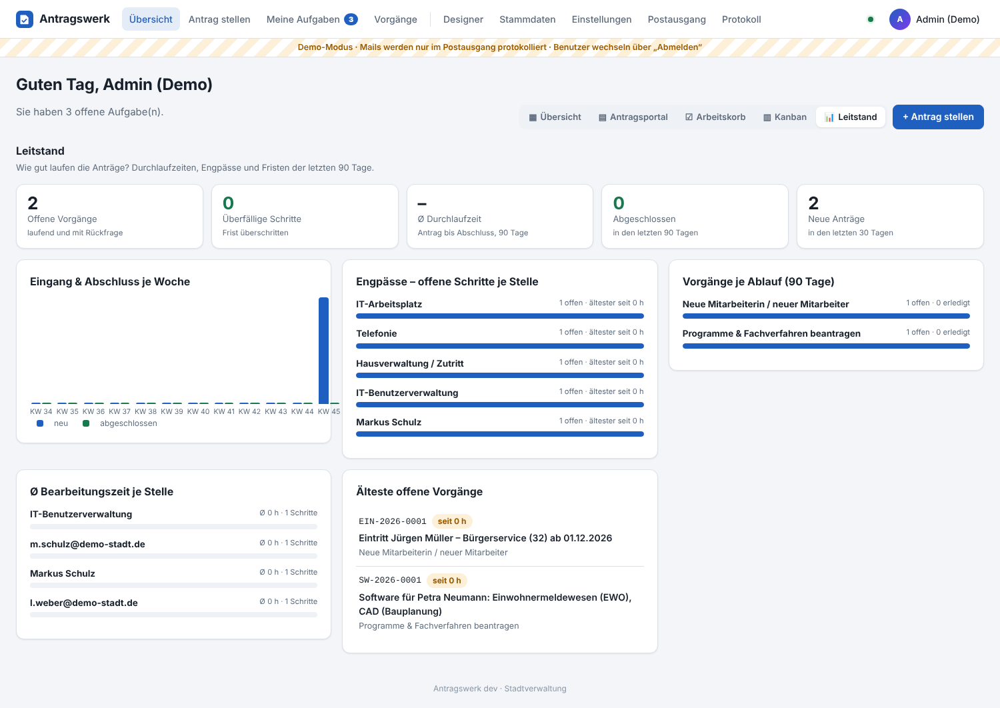
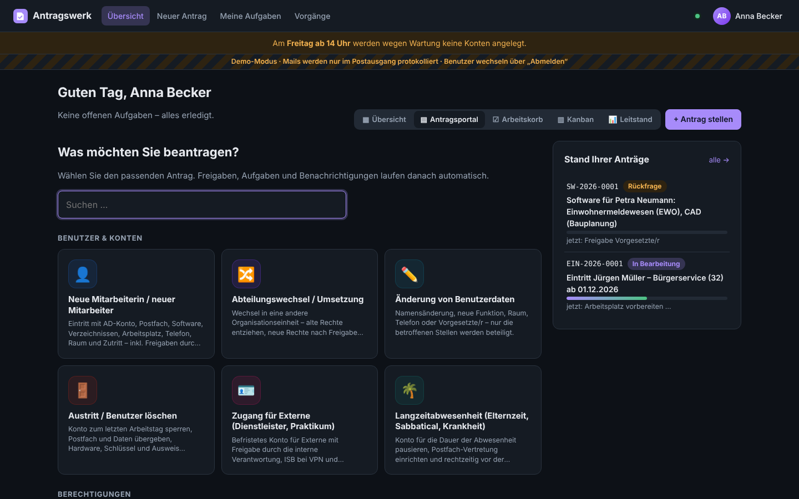
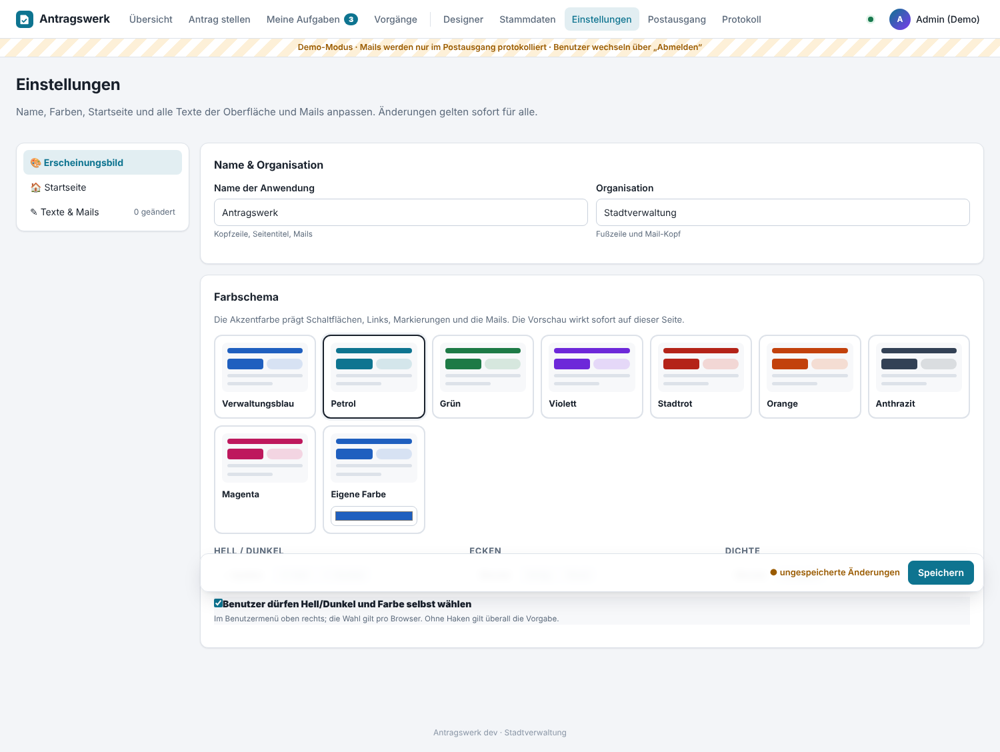

# Antragswerk

Webbasierte Antrags-Workflows in Go – gebaut für die Benutzerverwaltung im Active Directory:
Eintritt, Änderung, Abteilungswechsel, Austritt, Software- und Verzeichnisberechtigungen, externe Zugänge.

* **Formulare** mit Eingabegruppen, Pflichtfeldern, Bedingungen und **wiederholbaren Gruppen** (z. B. „Programm hinzufügen“ n-mal)
* **Abläufe** mit Freigaben, Aufgaben, Benachrichtigungen und Terminen – **parallel**, **bedingt** und **je Eintrag**
  (eine Freigabe je beantragtem Programm, ein Gruppen-Schritt je Verzeichnis …)
* **Zuständigkeit** aus Stellen, Personen im Antrag (Vorgesetzte/r) oder **Katalogen** (Verfahrensverantwortung je Software,
  Dateneigentümer je Verzeichnis, Leitung je Abteilung)
* **PowerShell-Skripte je Schritt mit den Antragsdaten** – kopieren oder als `.ps1` herunterladen (UTF-8 mit BOM für PS 5.1)
* **Mails** an die Zuständigen mit To-do, Checkliste, Antragsdaten und Link direkt zum Schritt (optional ohne Anmeldung bestätigen)
* **Lückenloser Nachweis**: Verlauf, Freigaben mit Kommentar, Ergebnisse, Mails, druckbarer Nachweis
* **Grafischer Designer** im Stil des LeakGuard-Workflow-Editors: Formular-Baukasten, Ablaufgraph, Skript-Editor mit Live-Vorschau,
  Testdaten-Simulation, Prüfung, Versionen

## Schnellstart

```bash
go build -o antragswerk ./cmd/antragswerk
./antragswerk -config config.yaml      # legt beim ersten Start eine Demo-Konfiguration an
```

Dann <http://localhost:8080> öffnen. Im Demo-Modus gibt es Beispielpersonen (Kennwort `demo`) – auf der Anmeldeseite per Klick:

| Person | Rolle im Demo |
|---|---|
| Anna Becker | Personalabteilung – stellt Anträge |
| Markus Schulz | Vorgesetzter – gibt frei |
| Sabine Wagner, Laura Weber | Verfahrensverantwortliche / Dateneigentümer |
| Thomas Klein | IT-Benutzerverwaltung (AD-Skripte) |
| Julia Hoffmann | Exchange & Telefonie |
| Klaus Richter | Hausverwaltung (Räume, Schlüssel, Zutritt) |
| admin | Administration (Designer, Stammdaten) |

Ohne SMTP landen alle Mails im **Postausgang** – die Links darin funktionieren, so lässt sich der ganze Ablauf durchspielen.

Docker: `docker compose up -d --build` (Konfiguration und Datenbank unter `./data`). Produktivbetrieb: `config.example.yaml`
nach `data/config.yaml` kopieren, `demo: false`, LDAP und SMTP eintragen.

## Begriffe

| Begriff | Bedeutung |
|---|---|
| **Ablauf** | Formular + Schritte + berechnete Werte. Versioniert: Speichern = Entwurf, Veröffentlichen = neue Version. Laufende Vorgänge bleiben auf ihrer Version. |
| **Vorgang** | ein gestellter Antrag, Nummer `PRÄFIX-JJJJ-NNNN` (z. B. `EIN-2026-0001`) |
| **Schritt** | Freigabe · Aufgabe · Benachrichtigung · Termin abwarten |
| **Stelle** | zuständige Einheit/Rolle (IT-Benutzerverwaltung, Exchange, Hausverwaltung …) mit Funktionspostfach, Mitgliedern und/oder AD-Gruppe |
| **Katalog** | Stammdatenliste mit frei definierbaren Attributen (Software → AD-Gruppen, Verfahrensverantwortung …) |
| **Variable** | globale Umgebungswerte (Domäne, OUs, Freigaben, Benutzernamen-Schema) |

### Ablaufregeln

* Ein Schritt startet, wenn **alle** Vorgänger abgeschlossen sind. Mehrere Nachfolger laufen **parallel**.
* **Bedingung** nicht erfüllt → der Schritt **entfällt**, Nachfolger laufen trotzdem (bedingte Zweige ohne Sonderlogik).
* **Je Eintrag**: für jede Zeile einer wiederholbaren Gruppe bzw. jeden Wert einer Mehrfachauswahl entsteht ein eigener Schritt –
  mit eigener Zuständigkeit (`katalog` → z. B. `software.verantwortlich`) und eigener Bedingung (`item.software.freigabe = ja`).
* **Freigabe**: Freigeben · Ablehnen (beendet den Vorgang, Begründung Pflicht) · **Rückfrage** (Antragsteller/in ergänzt das
  Formular, Änderungen werden im Verlauf als Diff dokumentiert, die Freigabe geht erneut an dieselbe Stelle).
* **Aufgabe**: Checkliste, Skripte, **Ergebnisfelder** (z. B. tatsächlich vergebener Benutzername) – stehen späteren Schritten als
  `{{.out.<schritt>.<feld>}}` zur Verfügung.
* **Termin**: wartet bis 7:00 Uhr am Datum aus dem Antrag (± Tage), z. B. „letzter Arbeitstag“ oder „Löschfrist +90 Tage“.
* Fristen je Schritt, einmalige Erinnerung bei Überschreitung, **Weiterleiten/Vertretung**, Zurückziehen, Notizen.

## Mitgelieferte Abläufe (Vorschläge)

| Ablauf | Freigaben | Parallele Arbeitsschritte |
|---|---|---|
| **Neue Mitarbeiterin / neuer Mitarbeiter** | Vorgesetzte/r → je Fachverfahren Verfahrensverantwortung ∥ je Verzeichnis Dateneigentümer | Arbeitsplatz ∥ Telefon ∥ Raum & Zutritt (direkt nach Vorgesetztenfreigabe) → AD-Konto & Gruppen (4 Skripte) → Postfach ∥ Konto im Fachverfahren je Programm ∥ VPN ∥ Diensthandy → Übergabe → Info an Vorgesetzte |
| **Abteilungswechsel / Umsetzung** | abgebende ∥ aufnehmende Leitung (aus Katalog) → je neues Programm/Verzeichnis | Raum & Zutritt vorab → Stichtag → AD: OU, Attribute, neue Gruppen, alte Gruppen entziehen (mit Übergangsfrist) ∥ Rechteentzug je Fachverfahren ∥ Telefon ∥ Umzug |
| **Änderung von Benutzerdaten** | Personal (nur bei Name/Funktion) | nur die betroffenen Stellen: AD-Attribute, Mailadresse (Alias), Raum, Telefon, Info an Fachverfahren |
| **Austritt / Benutzer löschen** | Personal; später Vorgesetzte/r vor endgültiger Löschung | Vorab-Info → letzter Tag → Sperren & Gruppen sichern/entfernen → Postfach in Shared + Weiterleitung ∥ Ablage übergeben ∥ Fachverfahren sperren ∥ Hardware ∥ Schlüssel/Ausweis ∥ Rufnummer → Löschfrist → Löschung. Variante „sofortige Sperrung“. |
| **Programme & Fachverfahren beantragen** | Vorgesetzte/r → je Programm Verfahrensverantwortung | je Programm: AD-Gruppen → Installation/Lizenz ∥ Einrichtung im Verfahren |
| **Zugriff auf Verzeichnisse & Postfächer** | Vorgesetzte/r → je Verzeichnis Dateneigentümer ∥ je Postfach Verantwortliche | Gruppen setzen → Info |
| **Zugang für Externe** | interne Verantwortung → ISB (bei VPN/Admin-Rechten) ∥ Datenschutz (bei personenbezogenen Daten, AV-Vertrag) | befristetes Konto → Enddatum → Zugang entfernen |
| **Langzeitabwesenheit** | Personal | Beginn abwarten → Konto pausieren (alte OU wird gemerkt) ∥ Postfach-Vertretung & Abwesenheitsnotiz; Gerät zurück → 10 Tage vor Rückkehr Info an Vorgesetzte → Rückkehrtag → Reaktivieren & Postfach zurückstellen |
| **Administratives Konto (Tier-Modell)** | Vorgesetzte/r → ISB → IT-Leitung (nur Tier 0) | Konto `adm-<tier>-…` in Tier-OU, Protected Users, nicht delegierbar, Smartcard (T0), Ablaufdatum → Erinnerung 14 Tage vorher → automatische Sperraufgabe |
| **Funktionspostfach oder Verteiler anlegen** | verantwortliche Person | Postfach/Verteiler + Berechtigungsgruppe + Mitglieder (Vollzugriff, Senden als) → Aufnahme in den Katalog „Funktionspostfächer“ → Info |
| **Gastzugang WLAN für Veranstaltung** | – | Voucher erzeugen (Ergebnisfeld) → Zugangsdaten per Mail an Antragsteller/in |
| **Rezertifizierung von Berechtigungen** | – (Start durch ISB/IT) | je Verzeichnis Dateneigentümer ∥ je Postfach Verantwortliche prüfen (mit Mitgliederliste per Skript) → IT setzt alle Rückmeldungen um (gesammelte Liste) → Abschlussbericht an ISB |

Alle Abläufe sind Vorschläge – im Designer anpassen, kopieren, deaktivieren oder als Vorlage für eigene Abläufe nutzen.
Neue mitgelieferte Abläufe, Stellen und Variablen späterer Versionen werden beim Start ergänzt; Vorhandenes wird nie überschrieben,
bewusst Gelöschtes kommt nicht zurück.

### Anträge deaktivieren

Im Designer (**⏸ Deaktivieren**) oder in der Designer-Übersicht – optional mit Hinweistext für Antragstellende
(z. B. „bis 30.11. bitte formlos an …“). Deaktivierte Anträge verschwinden aus „Antrag stellen“ und der Übersicht,
direkte Links zeigen den Hinweis, die API lehnt neue Anträge ab. **Laufende Vorgänge werden normal zu Ende bearbeitet**
(inkl. Rückfragen). Die Administration sieht deaktivierte Anträge unter „Antrag stellen“ ausgegraut und kann sie mit
**▶ Aktivieren** jederzeit wieder freischalten. Wer wann deaktiviert hat, steht im Designer und im Protokoll.

## Weitere mitgelieferte Anträge

| Ablauf | Freigaben | Ablauf |
|---|---|---|
| **Mobiles Arbeiten / VPN-Zugang** | Vorgesetzte/r → Personal (Vereinbarung) | Notebook ∥ Hardware-Token (falls gewählt) → VPN freischalten → Info; bei Befristung automatischer Rückbau |
| **Neues Verzeichnis / Netzlaufwerk** | Leitung der Einheit (Katalog) → Datenschutz bei hohem Schutzbedarf | Ordner, RO/RW-Gruppen, NTFS ohne Vererbung, erste Mitglieder (Skript) → Aufnahme in Katalog → Info an Dateneigentümer |
| **Datenwiederherstellung** | Dateneigentümer (nur bei fremder Ablage) | Restore mit Ergebnisfeld „wo liegen die Daten“ → Info |
| **Arbeitsplatzausstattung** | Vorgesetzte/r → IT-Leitung bei Notebooks | Bestellen/Lager → Info (Positionen als wiederholbare Gruppe) |
| **Sicherheitsausnahme** (USB, Webseite, lokale Adminrechte, Software) | Vorgesetzte/r → ISB | Umsetzen (Skript je Art) → Enddatum → automatischer Rückbau → Info ISB |
| **Verlust oder Diebstahl** | keine – alles startet sofort parallel | Sitzungen beenden & Kennwort ∥ Geräte sperren/fernlöschen ∥ Ausweis/Schlüssel sperren ∥ Meldung ISB ∥ Prüfung Meldepflicht Art. 33 DSGVO (72 h) → Ersatz |

## Anpassen ohne Programmierung (Einstellungen)

**Einstellungen → Erscheinungsbild:** Name der Anwendung, Organisation, Farbschema (8 Vorlagen oder eigene Farbe),
Hell/Dunkel/System, Ecken, Dichte. Optional dürfen Benutzer im Benutzermenü selbst Hell/Dunkel und eine Farbe wählen (pro Browser).
Die Mails übernehmen Farbe und Namen.

**Einstellungen → Startseite:** fünf Ansichten, je Rolle eine Vorgabe, welche wählbar sind (Umschalter oben auf der Startseite),
Willkommenstext und ein Hinweisbanner für alle Seiten (z. B. Wartungsfenster).

| Ansicht | für | zeigt |
|---|---|---|
| Übersicht | alle | Kennzahlen, eigene Aufgaben und Anträge, Schnellstart, Aktivität |
| Antragsportal | Antragstellende | große Kacheln mit Suche, Stand der eigenen Anträge |
| Arbeitskorb | Bearbeitung | offene Schritte nach Stelle gruppiert, Überfälliges zuerst, „alle Stellen“ umschaltbar |
| Kanban | Leitung/IT | Vorgänge als Karten in Freigabe · Umsetzung · Termin · Rückfrage · erledigt (14 Tage) |
| Leitstand | Leitung | Durchlaufzeit, Überfälliges, Eingang/Abschluss je Woche, Engpässe und Ø Bearbeitungszeit je Stelle, älteste Vorgänge |

**Einstellungen → Texte & Mails:** rund 150 Texte – Navigation, Startseite, Formular, Schaltflächen, Statusnamen, Meldungen,
Anmeldeseite und **alle Standard-Mails** (als Vorlagen mit Platzhaltern). Leer = Vorgabe; Export/Import als JSON.
Texte eines Ablaufs (Felder, Schritte, Hinweise, eigene Mails je Schritt) bleiben im Designer.

## Organisationsstruktur aus dem Telefonbuch (Datenquellen)

**Stammdaten → Datenquellen** übernimmt Daten aus einer JSON-Quelle (URL mit optionalem Token oder Datei) – z. B. aus dem
internen Telefonbuch – und hält sie automatisch aktuell (Intervall in Minuten oder manuell):

* **Kataloge**, z. B. Organisationseinheiten (inkl. Hierarchie → Gruppe, Leitung, Kostenstelle) und Räume.
  Nur zugeordnete Felder werden überschrieben; was nur in Antragswerk gepflegt wird (OU, Standardgruppen, Laufwerk …), bleibt.
  Fehlt eine Einheit in der Quelle, wird sie inaktiv (laufende Vorgänge bleiben gültig). Einträge aus Quellen sind mit ⇄ markiert.
* **Personenverzeichnis**: ergänzt die Personensuche in Anträgen (auch ohne LDAP) und füllt bei AD-Treffern fehlende
  Angaben wie Telefon, Raum und Funktion.
* Zuordnung über Vorlagen (`{{.name}}`, `{{.head.mail}}`, `{{.uebergeordnet.name}}`, Filter), **Testen** zeigt die Vorschau
  ohne Übernahme inklusive der verfügbaren Felder des ersten Datensatzes.

### Anbindung des Telefonbuchs (pbucng)

Das Telefonbuch bietet dafür den Organisations-Export `GET /api/export/org` (Format `telefonbuch-org/1`, ab der Version mit
`orgExport`). Einrichtung:

1. **Telefonbuch:** Token setzen – `"orgExport": {"token": "…"}` in der `config.json` oder `TB_ORG_EXPORT_TOKEN` /
   `TB_ORG_EXPORT_TOKEN_FILE`. Ohne Token gibt es den Endpunkt nicht.
2. **Antragswerk:** Stammdaten → Datenquellen → „+ Neue Quelle (Vorlage Telefonbuch)“, URL
   `https://<telefonbuch>/api/export/org`, Kopfzeile `Authorization: Bearer <Token>`, **Testen**, speichern, **Jetzt abgleichen**.

Was die Vorlage übernimmt (alles änderbar):

| Telefonbuch | Antragswerk | Hinweise |
|---|---|---|
| Einheiten mit Kürzel unterhalb der obersten Ebene | Katalog **Organisationseinheiten**, Schlüssel = Kürzel | Bezeichnung „Name (Kürzel)“, Gruppe = oberste Einheit (Dezernat); `leitung` = Mail der wirksamen Leitung (fest eingetragen oder per Leitungs-Schlagwort der Ebene, sonst geerbt), `vertretung`, `verteiler` (Kontaktweg), `ebene`, `uebergeordnet`. **OU, Standardgruppen, Laufwerk, Kostenstelle bleiben hier gepflegt.** Entfällt eine Einheit → inaktiv. |
| Personen mit Anmeldenamen | **Personensuche** | Name, Mail, Telefon, Raum, Einheit „Name (Kürzel)“, Funktion („Leitung Amt“), Vorgesetzte/r |
| vergebene Räume | Katalog **Räume**, Schlüssel = Raumangabe im Telefonbuch | nur `abteilung` und `personen` werden gesetzt; Bezeichnung, Gebäude, Schließgruppe, Zutrittsprofil bleiben hier gepflegt. Neue Räume erscheinen automatisch (Attribute dann ergänzen). |

Damit vorhandene Einträge zusammenfinden, müssen die **Schlüssel übereinstimmen**: Kürzel der Einheit im Telefonbuch = Schlüssel im
Katalog, Raumangabe im Telefonbuch = Schlüssel des Raums. Einträge ohne Gegenstück im Telefonbuch bleiben unverändert.
Die Beispieldatei `internal/web/static/telefonbuch-beispiel.json` ist mit dem Export des Telefonbuchs erzeugt und im
Demo-Modus als Quelle eingerichtet.

Die Richtung ist bewusst einseitig: Neue Konten aus dem Eintritts-Ablauf landen über den AD-Abgleich des Telefonbuchs dort,
die Organisation wird nur im Telefonbuch gepflegt.

Andere Quellen lassen sich über die Vorlagen abbilden – auch verschachtelte Hierarchien (`children` → `{{.uebergeordnet.name}}`,
`{{.pfad}}`, `{{.ebene}}`). Fehlt ein verschachteltes Feld, bleibt der Wert leer.

## GLPI: Tickets und Changes aus dem Ablauf

Die Schrittart **„GLPI-Ticket/Change“** übergibt an GLPI und wartet auf die Lösung. Genutzt wird ausschließlich die
**moderne GLPI-API (High-Level-API v2, ab GLPI 11) mit OAuth2** – nicht die alte REST-API (`apirest.php`).

**Einrichtung:** Einstellungen → Schnittstellen → „+ GLPI-Verbindung“: Adresse, OAuth-Client (Grant *Password* mit
Dienstkonto oder *Client credentials*, Scope `api`), Standard-Entität, Abfrageintervall, Webhook-Geheimnis.
„Verbindung testen“ prüft Anmeldung und Leserechte, „IDs nachschlagen“ sucht Gruppen, Benutzer, Kategorien, Orte usw.

| Was | Einstellbar im Designer (alles Vorlagen mit Antragsdaten) |
|---|---|
| Aktion | **Neu anlegen** (Ticket oder Change) oder **Folgeeintrag** zu einem Ticket aus einem früheren Schritt |
| Ticket | Titel, Beschreibung, Typ (Störung/Anfrage), Status, Dringlichkeit, Auswirkung, Priorität, Entität, Kategorie, Ort, Anfragequelle, Lösungsfrist, externe ID |
| Change | dazu Auswirkungsanalyse, Kontrollliste, Einführungs-, Rückfall- und Checkliste (`impactcontent` … `checklistcontent`) |
| Team | Zugewiesen / Beobachter / Anforderer – Gruppen, Benutzer, Lieferanten per Name oder ID (mehrere mit `;`) |
| Aufgaben | Text, Techniker/in, Techniker-Gruppe, Kategorie, Dauer, Status, Beginn/Ende, privat, Bedingung |
| Genehmigung | Genehmigung in GLPI anfordern (Gruppe oder Benutzer, Text) |
| Weitere Felder | beliebige Felder der API v2 als JSON-Vorlage (überschreibt) |
| Warten | „wenn gelöst“ (Status wählbar, Vorgabe Ticket: Gelöst/Geschlossen, Change: Angewendet/Überprüfung/Geschlossen) oder „sofort nach Übergabe“ |
| Gescheitert | Status wählbar (Vorgabe Change: Abgelehnt/Abgebrochen) → Aufgabe für die Zuständigen, Antrag ablehnen oder trotzdem weiter |

Namen (z. B. Kategorie „IT > Benutzerkonten“, Gruppe „IT-Benutzerverwaltung“) werden beim Senden in IDs aufgelöst; IDs gehen
direkt (`12` oder `#12`). „▶ Vorschau der Übergabe“ zeigt die Anfragen an GLPI mit Testdaten. Mit „je Eintrag“ entsteht
ein Ticket je Eintrag (z. B. je Gerät).

**Rückmeldung aus GLPI ins Antragswerk** – drei Wege, frei kombinierbar:

1. **Rückmeldelink im Ticket:** `{{.glpi.rueckmeldung}}` im Tickettext öffnet ohne Anmeldung eine Seite, auf der
   Techniker/innen „Erledigt“ oder „Problem“ melden und die **Rückmeldefelder** des Schritts ausfüllen.
   Für Skripte/Automatisierung: `POST {{.glpi.api}}` mit JSON `{"status":"erledigt","von":"…","kommentar":"…","felder":{"inventar":"NB-1"}}`
   oder als Formular.
2. **Status in GLPI:** Das Antragswerk fragt offene Tickets im eingestellten Abstand ab. Ist der Status erreicht, werden Lösung
   und Folgeeinträge gelesen; Zeilen wie `Inventarnummer: NB-1` oder `inventar = NB-1` füllen die Rückmeldefelder.
3. **Webhook (sofort):** In GLPI unter Einrichtung → Webhooks für Ticket/Change (optional Folgeeintrag, Lösung), Ereignis
   „Aktualisierung“, Methode POST, URL `https://<antragswerk>/api/glpi/webhook/<schlüssel>`, Geheimnis wie in der Verbindung.
   Die Signatur `X-GLPI-signature` (HMAC-SHA256 über Body + `X-GLPI-timestamp`) wird geprüft; der Inhalt stößt nur die
   Abfrage an – maßgeblich ist immer der Stand per API.

Im Text verfügbar: `{{.glpi.rueckmeldung}}`, `{{.glpi.api}}`, `{{.glpi.ref}}` (Vorgangsnummer/Schritt, Standard der externen ID),
`{{.glpi.vorgang}}`, `{{.glpi.token}}`, `{{.zusammenfassung}}`. Spätere Schritte nutzen `{{.out.<schritt>.glpi_id}}`,
`glpi_url`, `glpi_status_name`, `glpi_solution` und die Rückmeldefelder.

**Robust:** Die Übergabe läuft im Hintergrund (nie unter der Vorgangssperre). Ist GLPI nicht erreichbar, folgen bis zu vier
Versuche (sofort, 1, 5, 15 min); danach wird der Schritt zur Aufgabe für die eingestellte Stelle. Existiert ein Ticket schon,
wird es nie doppelt angelegt – scheitern nur Team/Aufgaben, steht das als Hinweis am Schritt. Auf der Vorgangsseite:
„Status abfragen“, „erneut übergeben“, „Manuell übernehmen“.

Beispiele: **„Änderung an der IT (Change)“** (Freigabe IT-Leitung → Change mit CAB-Genehmigung, Plänen, Aufgabe; abgelehnt
→ Antrag abgelehnt) und **„Gerät anfordern (über GLPI)“** (ein Ticket je Gerät, Inventarnummer kommt zurück). Im Demo-Modus
läuft ein eingebautes **Test-GLPI** unter `/demo-glpi/` (gleiche API, Tickets dort lösen → Webhook → Antrag läuft weiter).

## Skripte und Vorlagen

Texte, Mails und Skripte sind Go-Vorlagen. Werte aus dem Antrag stehen direkt zur Verfügung:

```powershell
$sam = {{ps .c.sam}}                                             # berechneter Wert, sicher in '…'
New-ADUser -Name {{ps .c.anzeigename}} -Path {{ps .abteilung.ou}}  # Katalog-Attribut der gewählten Abteilung
$gruppen = {{psarr (pluck .programme "software.ad_gruppen")}}   # alle Gruppen aller beantragten Programme
{{- range .verzeichnisse}}
Add-ADGroupMember {{if eq .zugriff "aendern"}}{{ps .verzeichnis.gruppe_rw}}{{else}}{{ps .verzeichnis.gruppe_ro}}{{end}} -Members $sam
{{- end}}
```

| Ausdruck | Ergebnis |
|---|---|
| `.feld` | Wert; Auswahlfelder zusätzlich `.feld_text` (Beschriftung) |
| `.katalogfeld.attr` / `.katalogfeld.label` | Attribut bzw. Bezeichnung des gewählten Eintrags |
| `.person.sam` `.mail` `.name` `.given` `.surname` `.department` `.title` `.phone` | Personenfeld (AD) |
| `.item…`, `.index` | aktueller Eintrag bei „je Eintrag“ |
| `.c.key` | berechnete Werte (Einstellungen), z. B. Benutzername, UPN, Ziel-OU |
| `.out.schritt.feld`, `.out.schritt.von` | Ergebnisse/Bearbeiter früherer Schritte |
| `{{range .out.schritt.liste}}{{.eintrag}}: {{.feld}}{{end}}` | Ergebnisse **aller** Einträge eines „je Eintrag“-Schritts (z. B. Rückmeldungen je Verzeichnis) |
| `.var.key` | globale Variablen |
| `.antrag.nummer` `.titel` `.antragsteller_name` `.link` | Vorgang |
| `ps`, `psarr`, `pstrue`, `psdate` | PowerShell-sicheres Quoting |
| `pluck`, `split`, `concat`, `join`, `uniq`, `has`, `count` | Listen |
| `sam`, `ascii`, `lower`, `upper`, `left`, `replace`, `default` | Text (Umlaute → ae/oe/ue/ss) |
| `datum`, `date`, `addDays`, `today` | Datum |

Im Designer hilft **{ } Variable** beim Einfügen, **⧉ Baustein** übernimmt Skriptbausteine aus den Stammdaten,
**▶ Mit Testdaten** zeigt das fertige Skript mit den Testdaten aus „Test & Vorschau“.

## Build, Tests und Veröffentlichung (GitHub Actions)

| Workflow | Wann | Was |
|---|---|---|
| `.github/workflows/ci.yml` | Pull Requests, Pushes auf Arbeitszweige, vor jedem Release | `go mod tidy`, `gofmt`, `go vet`, Tests mit `-race`, `govulncheck`, JavaScript-Syntax; **Rauchtest im Browser** (`tests/e2e/smoke.mjs`) gegen einen Demo-Server; Docker-Image baut |
| `.github/workflows/release.yml` | Push auf `main`, Tags `v*` | Image `ghcr.io/<owner>/<repo>` für amd64 + arm64 (SBOM, Herkunftsnachweis), Programme für Linux, Windows, macOS; bei Tags GitHub Release mit `SHA256SUMS.txt` (`v1.2.3-rc.1` → Vorabversion, ohne `latest`) |
| `.github/dependabot.yml` | wöchentlich | Actions, Go-Module, Basis-Image, Playwright |

Der Rauchtest klickt jeden Menüpunkt bei 1500, 1280 und 1150 px Breite an (auch im „Mehr ▾“-Menü), navigiert mit
10 offenen Tabs und prüft, dass ein neuer Antrag in allen Tabs live ankommt. Lokal:

```bash
go run ./cmd/antragswerk &                     # Demo-Server
cd tests/e2e && npm install && npx playwright install chromium && node smoke.mjs
```

**Live-Aktualisierung und viele Tabs:** Browser öffnen über HTTP/1.1 höchstens 6 Verbindungen je Server. Alle Tabs teilen
sich deshalb eine Live-Verbindung (Web Locks + BroadcastChannel). Web Locks gibt es nur über HTTPS bzw. `localhost` – bei
`http://servername` verbinden sich nur sichtbare Tabs. Im Betrieb hinter einem HTTPS-Reverse-Proxy (z. B. Caddy) gilt mit
HTTP/2 die Grenze ohnehin nicht mehr.

## Rechte

| Rolle | aus | darf |
|---|---|---|
| nutzer | alle (bzw. `roles.nutzer`) | Anträge stellen, eigene Vorgänge sehen, zugewiesene Schritte bearbeiten |
| bearbeiter | `roles.bearbeiter` | zusätzlich alle Vorgänge und den Postausgang sehen |
| admin | `roles.admin` | Designer, Stammdaten, Protokoll, jeden offenen Schritt bearbeiten (Vertretung) |

Schritte bearbeiten dürfen die Zuständigen: direkt (Mail/Anmeldename) oder als Mitglied der Stelle
(Mitgliederliste oder AD-Gruppe, verschachtelt). Über Mail-Links bestätigte Schritte werden als „per Mail-Link“ dokumentiert.

## Aufbau

```
cmd/antragswerk          Programmstart, Hintergrundlauf (Termine, Erinnerungen)
internal/flow            Definitionen, Bedingungen, Vorlagen, Simulation (ohne DB/HTTP)
internal/app             Ablaufsteuerung: Antrag, Freigaben, Rückfrage, Mails
internal/store           SQLite (modernc, ohne CGO)
internal/dir             LDAP-Anmeldung, Personensuche, Demo-Verzeichnis
internal/orgsync         Datenquellen (Telefonbuch u. a.) → Kataloge und Personenverzeichnis
internal/glpi            GLPI-API v2 (OAuth2), Namensauflösung, Test-GLPI für Demo/Tests
internal/ui              Einstellungen: Texte, Farbschemata, Startseiten-Ansichten
internal/seed/data       mitgelieferte Abläufe, Kataloge, Stellen, Variablen, Skriptbausteine (YAML)
internal/web             Seiten, API, statische Dateien (form.js, designer.js, master.js)
```

Abläufe lassen sich als YAML exportieren/importieren. Mitgelieferte Abläufe werden nur installiert, wenn ihr Schlüssel fehlt –
eigene Änderungen werden nie überschrieben.

Tests: `go test ./...` (Validierung aller Abläufe, Rendern aller Skripte, Ablaufsteuerung inkl. Rückfrage, Ablehnung, Terminen, „je Eintrag“).

## Ansichten

| | |
|---|---|
|  |  |
|  |  |
|  |  |
|  |  |
|  |  |
